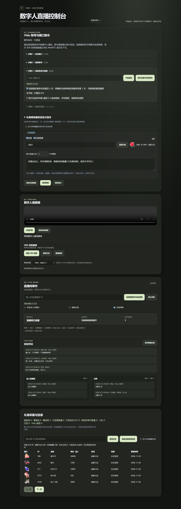
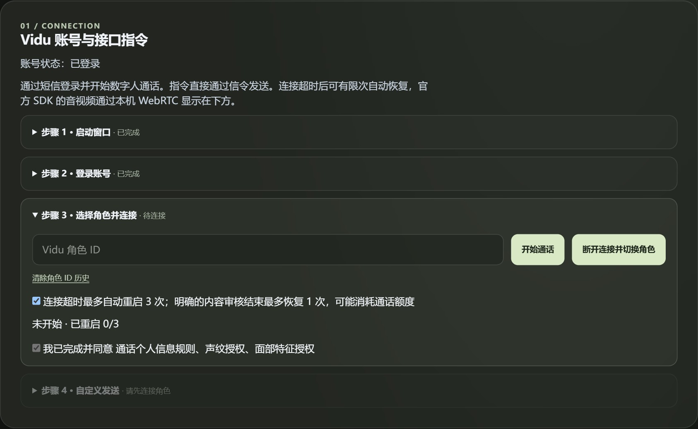
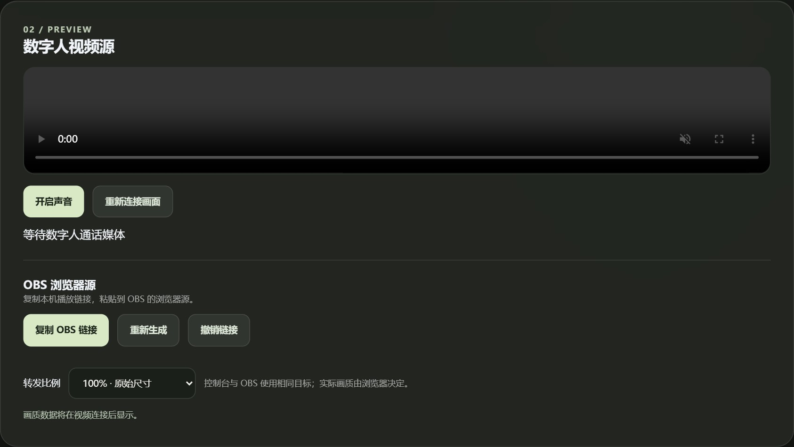
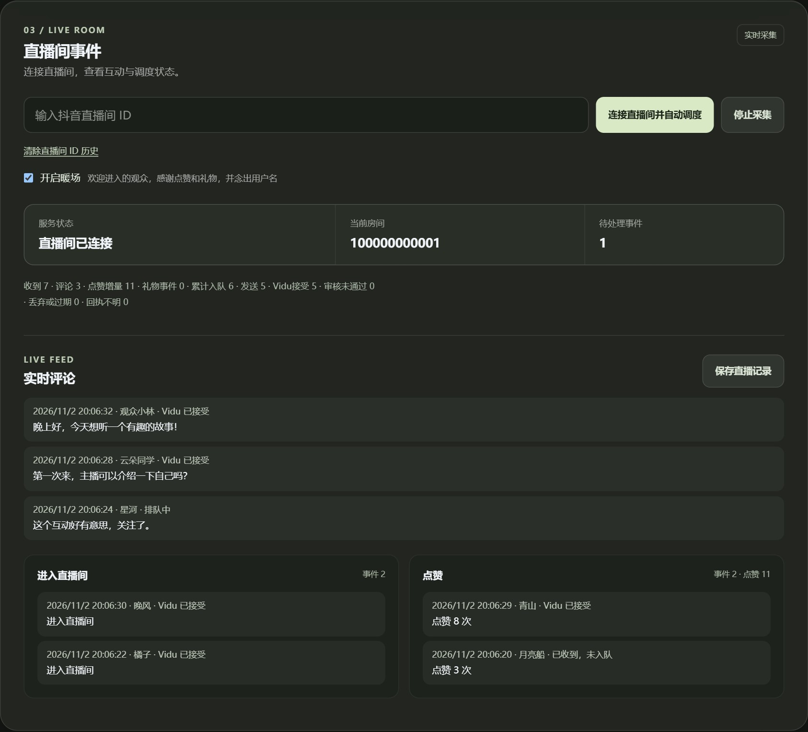

<h1 align="center">Vidu Live Studio</h1>

<h4 align="center">数字人直播桥 · 把直播间互动，连接到数字人的实时通话。</h4>

  基于 FastAPI、Playwright 与 WebRTC 的本地直播控制台。 
  管理 Vidu 通话、调度抖音直播事件，并将音视频接入 OBS。

  
  
  
  

  <a href="#功能亮点">功能亮点</a> ·
  <a href="#界面预览">界面预览</a> ·
  <a href="#快速开始">快速开始</a> ·
  <a href="#使用流程">使用流程</a> ·
  <a href="#开发与验证">开发与验证</a> ·
  <a href="#许可证">许可证</a>

  
   当前前端的隔离演示截图：账号状态与事件为虚构数据，视频未连接。

## 功能亮点

| 功能 | 你可以做什么 |
| --- | --- |
| 分步连接 | 按启动窗口、登录账号、选择角色、发送指令四步操作，实时查看处理状态。 |
| 直播互动调度 | 欢迎进入直播间、谢谢点赞、回复弹幕三个独立开关；礼物独立聚合和调度。 |
| 礼物自定义指令 | 按礼物 ID 绑定指令和数量门槛，默认先答谢用户；支持图片目录与同连击一次触发。 |
| 音视频预览 | 查看数字人音视频，开启声音、重新连接画面，并观察源轨道和收发画质。 |
| OBS 接入 | 复制本机浏览器源链接；支持控制台与 OBS 并行接收，转发比例可选 100%、80%、50%。 |
| 有限自动恢复 | 对明确的超时和时长上限退避重试；恢复期间尽量保留最后一帧，手动停止立即取消。 |
| 历史与记录 | 手机号、角色和房间提供历史候选；消息支持回车发送和高频历史选择；完整直播记录可导出。 |
| 本机会话隔离 | 各会话独立管理通话与事件；登录 Cookie 使用 Windows DPAPI 加密保存，最长可恢复 24 小时。 |

## 界面预览

### 一步一步，建立数字人连接

已完成步骤自动折叠，未完成的前置步骤会锁定后续操作。按钮附近显示执行结果，媒体连通后才解锁自定义发送。

### 预览画面，接入 OBS

声音、画面重连、OBS 链接和转发比例集中在视频源区域。通话恢复时显示最近缓存的画面，新帧到达后自动切换。

### 看清每一次互动的处理状态

评论置顶，进入和点赞各自展示；事件带时间戳，从新到旧排列。区分收到、排队、发送和服务端接受，并支持保存完整记录。

> 以上图片由项目当前前端渲染，使用隔离的虚构状态与事件；视频面板处于等待媒体状态。截图用于展示界面，不作为真实直播或媒体效果的验证证据。

## 快速开始

### 1. 准备环境

- Windows、Python 3.11 或以上、Git、Google Chrome。
- 可用的 Vidu 账号和属于自己的角色 ID。
- 独立安装 [douyinLive v2.3.2](https://github.com/jwwsjlm/douyinLive/releases/tag/v2.3.2) 直播事件采集器。

### 2. 下载项目并安装依赖

在 PowerShell 中运行：

~~~powershell
# 下载项目
git clone https://github.com/Zeaulo/vidu_reverse_digital_human.git
cd vidu_reverse_digital_human

# 创建独立 Python 环境并安装依赖
python -m venv .venv
.\.venv\Scripts\python.exe -m pip install -r requirements.txt
~~~

### 3. 配置采集器

从上述发行页面下载 **windows-amd64.zip**，核对发布页的 **checksums.txt** 后，解压至 **test/tools/douyin/**。目录中应有 **douyinLive.exe**。

已验证发行包的 SHA256：

~~~text
da050a808fe468e7d4702175bab6dd8a46565c7a38eb923c143c8797b5157375
~~~

将**采集器自带的 config.example.yaml** 复制为同目录的 **config.yaml**，并在对应配置项中设置以下值，保留文件内其他默认配置：

~~~yaml
port: '1088'
cookie:
  use_stored: false
websocket:
  allowed_origins:
    - 'http://127.0.0.1:8795'
~~~

最终目录：

~~~text
test/tools/douyin/
├── douyinLive.exe
├── config.example.yaml
└── config.yaml
~~~

采集器以访客身份运行，无须提供抖音登录 Cookie。其发行版可能监听所有网络接口，请将采集服务留在本机使用。

### 4. 一键启动

双击根目录的 **start.cmd**，或在 PowerShell 中运行：

~~~powershell
powershell -ExecutionPolicy Bypass -File test/start_studio.ps1
~~~

打开 **[http://127.0.0.1:8795](http://127.0.0.1:8795)**。

> 启动脚本会强制结束监听 **8795** 端口的进程，再启动控制台；旧进程里未导出的直播记录会丢失。**1088** 端口已有采集器时沿用该实例。

## 使用流程

1. **连接 Vidu**：启动有头 Chrome，登录账号，输入角色 ID 并等待媒体连接。保持 Vidu 窗口打开。
2. **连接直播间**：输入抖音直播间 ID，启动采集与自动调度。分别选择欢迎进入直播间、谢谢点赞、回复弹幕，默认仅开启回复弹幕。
3. **发送自定义指令**：在步骤 4 输入内容，点击发送或按回车；中文输入法选词不会触发发送。
4. **接入 OBS**：点击“复制 OBS 链接”，在同一电脑的 OBS 中添加“浏览器源”，粘贴地址并设置宽高。需要 OBS 混音时启用“通过 OBS 控制音频”。
5. **保存与结束**：先保存直播记录，再停止采集或通话。停止采集不挂断数字人；断开通话会取消自动恢复。

每次重新连接直播间都会清空上一轮记录。OBS 链接含媒体访问凭证，退出登录、撤销链接或重启服务后失效；授权与服务使用应由使用者自行确认。

### 恢复行为与使用边界

| 情况 | 当前处理方式 |
| --- | --- |
| 连接超时或 duration_limit | 启用自动恢复时，按 5／10／20 秒退避，每次手动开始最多重建三次。 |
| 单条内容审核拒绝 | 标记该条失败，不重发；不因单条拒绝主动挂断。 |
| 官网明确提示内容不符合规范且直播已结束 | 检查视频是否仍在增帧；确认停止后清空待发队列，开启自动恢复时五秒后最多尝试一次。再次触发则提示处理。 |
| 登录失效、额度结束、未知错误 | 提示用户处理，停止自动创建通话。 |

恢复创建新通话可能消耗 Vidu 额度。accepted=true 仅代表服务端接收指令，不能证明语音或动作已经完整执行。100% 转发表示请求原始尺寸，实际编码受浏览器、网络与计算资源影响。

详细操作与本地数据说明见 **[使用手册](docs/usage.md)**。

## 工作原理

~~~mermaid
flowchart LR
    D[抖音直播间] --> C[douyinLive 访客采集]
    C --> B[事件过滤与优先队列]
    U[自定义文字指令] --> W[Vidu 业务 WebSocket]
    B --> W
    W --> V[有头 Chrome 内的 Vidu 通话]
    V --> R[本机 WebRTC 中继]
    R --> S[Studio 音视频预览]
    R --> O[OBS 浏览器源]
~~~

FastAPI 管理本机会话和调度，Playwright 承载官方网页的登录与媒体环境。Chrome 负责上游 RTC，控制台与 OBS 通过本机 WebRTC 接收音视频。

## 开发与验证

~~~powershell
# API、事件、会话隔离与恢复逻辑测试
.\.venv\Scripts\python.exe -m pytest -q test

# 业务信令序号、回执与停止行为测试（需要 Node.js）
node test/test_runtime.cjs

# 使用隔离演示数据重新生成 README 截图
.\.venv\Scripts\python.exe test/capture_readme.py
~~~

| 目录 | 内容 |
| --- | --- |
| app/adapters/ | Vidu 浏览器、业务信令、媒体中继与抖音事件适配。 |
| app/services/ | 通话恢复、事件过滤与直播队列调度。 |
| app/api/、app/storage/ | 会话接口、OBS 访问、加密账号和事件归档。 |
| web/ | 控制台与 OBS 浏览器源页面。 |
| test/ | 启动、测试、排查与截图生成脚本。 |
| versions/ | 版本历史、实测记录与项目架构手册。 |

已记录真实评论采集、业务指令接受回执与音视频接收证据。自动恢复和 OBS 并行媒体链路已有模拟测试，真实审核结束后的恢复与实际 OBS 联调仍待验证；RTMP 推流未集成。音频输入实验仅证实 RTC 音轨上行，未证实业务 WebSocket 音频输入或数字人跟唱。

- [内部开发手册](versions/project_overall/index.html)（克隆后用浏览器打开）
- [真实联调记录](versions/integration-v0.4.0.md)
- [音频输入实验](versions/vidu-audio-probe-v0.13.1.md)
- [版本记录](versions/update.log)
- [反馈问题](https://github.com/Zeaulo/vidu_reverse_digital_human/issues)

## 致谢

本项目使用 [FastAPI](https://github.com/fastapi/fastapi)、[Playwright](https://github.com/microsoft/playwright-python)、[Pydantic](https://github.com/pydantic/pydantic)、[Tailwind CSS](https://github.com/tailwindlabs/tailwindcss) 与独立安装的 [douyinLive](https://github.com/jwwsjlm/douyinLive)。README 排版参考 [Markdownify](https://github.com/amitmerchant1990/electron-markdownify)。

## 许可证

项目自有代码以 **[MIT License](LICENSE)** 发布。Vidu、抖音、浏览器与第三方依赖分别遵循各自条款和许可证；本项目与这些服务无官方关联。仓库不包含第三方采集器二进制、登录 Cookie、参考歌曲或测试录音。

---

<a href="https://github.com/Zeaulo">Zeaulo</a> · <a href="https://github.com/Zeaulo/vidu_reverse_digital_human/issues">报告问题</a> · <a href="versions/update.log">更新记录</a>

